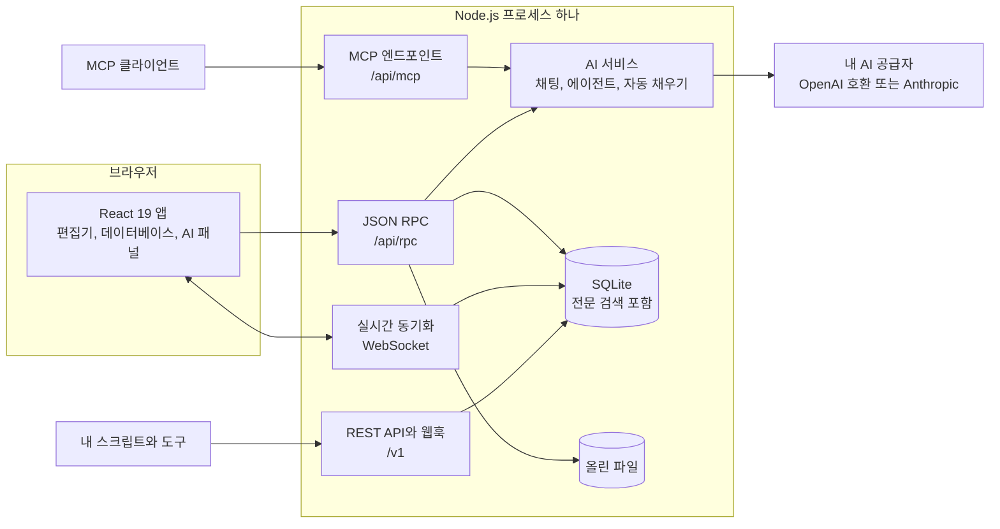

<p align="center">
  <picture>
    <source media="(prefers-color-scheme: dark)" srcset="docs/assets/readme/banner-dark.svg">
    
  </picture>
</p>

<p align="center">
  <a href="LICENSE"></a>
  
  
  
  
</p>

<p align="center">
  <a href="https://litpage-demo-production.up.railway.app"><b>라이브 데모</b></a> &nbsp;|&nbsp;
  <a href="#빠른-시작"><b>빠른 시작</b></a> &nbsp;|&nbsp;
  <a href="#기능-둘러보기"><b>기능 둘러보기</b></a> &nbsp;|&nbsp;
  <a href="#내-키로-쓰는-ai"><b>AI</b></a> &nbsp;|&nbsp;
  <a href="#api와-연동"><b>API</b></a> &nbsp;|&nbsp;
  <a href="#구조"><b>구조</b></a> &nbsp;|&nbsp;
  <a href="README.md"><b>English</b></a>
</p>

Litpage는 직접 운영하는 오픈소스 워크스페이스입니다. 블록 편집기로 문서를 쓰고, 페이지와 팀을 정리하고, 여러 보기를 갖춘 데이터베이스로 일을 관리하고, 세밀한 권한으로 공유하고, 내 API 키로 AI 채팅, 에이전트, 글쓰기 도움을 씁니다. 앱 전체가 Node.js 프로세스 하나와 SQLite 파일 하나로 동작해서 노트북이나 서버 한 대로 충분합니다.

> **데모 체험:** [litpage-demo-production.up.railway.app](https://litpage-demo-production.up.railway.app)을 열고 **Try the demo**를 누르세요. 가입은 필요 없습니다.
> 샘플 페이지가 담긴 나만의 워크스페이스가 만들어지고, 다른 사람은 볼 수 없으며, 4시간 뒤 삭제됩니다. 데모에는 AI가
> 연결되어 있지 않습니다.

<p align="center">
  <picture>
    <source srcset="docs/assets/readme/demo.webp" type="image/webp">
    
  </picture>
</p>

## 왜 Litpage인가

- **작고 직접 운영하기 쉽습니다.** 프로세스 하나, SQLite 데이터베이스 하나(`node:sqlite`, 전문 검색 포함), 파일은 폴더 하나에 둡니다. Postgres, Redis, 큐를 따로 띄울 필요가 없습니다.
- **문서와 데이터가 한곳에 있습니다.** 페이지, 블록 편집기, 데이터베이스가 같은 트리에 있어서 프로젝트 문서 옆에 작업 보드를 둘 수 있습니다.
- **함께 쓰기 좋습니다.** WebSocket 실시간 공동 편집, 댓글과 제안 편집, 버전 기록, 팀, 페이지 단위와 필드 단위 권한, 공개 공유와 사이트 게시를 지원합니다.
- **AI는 내 조건대로 씁니다.** 채팅, 맞춤 에이전트, AI 블록, 자동 채우기, 회의록 요약이 내가 설정한 공급자와 키로 동작합니다. 키가 없어도 나머지 기능은 모두 씁니다.
- **내 도구와 연결됩니다.** 웹훅을 갖춘 REST API와 AI 클라이언트용 MCP 엔드포인트를 제공하고, 토큰은 직접 관리합니다.
- **한국어와 영어를 지원합니다.** 화면 언어를 한국어와 영어 중에서 고릅니다.

## 기능 둘러보기

<table>
  <tr>
    <td width="50%" valign="top">
      <picture>
        <source media="(prefers-color-scheme: dark)" srcset="docs/assets/readme/editor-dark.webp">
        
      </picture>
      <p><b>블록 편집기.</b> 블록 41종, 슬래시 메뉴, 마크다운 단축키, 끌어 놓기, 멘션, 댓글과 제안 편집.</p>
    </td>
    <td width="50%" valign="top">
      <picture>
        <source media="(prefers-color-scheme: dark)" srcset="docs/assets/readme/board-dark.webp">
        
      </picture>
      <p><b>데이터베이스.</b> 형식이 있는 필드, 필터, 정렬, 그룹, 수식, 관계, 롤업, 템플릿, 버튼, 자동화.</p>
    </td>
  </tr>
  <tr>
    <td width="50%" valign="top">
      <picture>
        <source media="(prefers-color-scheme: dark)" srcset="docs/assets/readme/timeline-dark.webp">
        
      </picture>
      <p><b>같은 데이터, 여러 보기.</b> 표, 보드, 리스트, 갤러리, 캘린더, 타임라인, 차트, 대시보드, 피드, 폼, 지도.</p>
    </td>
    <td width="50%" valign="top">
      <picture>
        <source media="(prefers-color-scheme: dark)" srcset="docs/assets/readme/chart-dark.webp">
        
      </picture>
      <p><b>차트와 대시보드.</b> 데이터베이스에서 바로 막대, 가로 막대, 선, 도넛, 숫자 차트를 만듭니다.</p>
    </td>
  </tr>
  <tr>
    <td width="50%" valign="top">
      <picture>
        <source media="(prefers-color-scheme: dark)" srcset="docs/assets/readme/ai-dark.webp">
        
      </picture>
      <p><b>워크스페이스를 아는 AI.</b> 페이지 내용을 묻고, 글을 쓰고 고치고, 데이터베이스 필드를 채우고, 일정이나 이벤트에 맞춰 맞춤 에이전트를 실행합니다.</p>
    </td>
    <td width="50%" valign="top">
      <picture>
        <source media="(prefers-color-scheme: dark)" srcset="docs/assets/readme/korean-dark.webp">
        
      </picture>
      <p><b>한국어와 영어.</b> 설정에서 화면 언어를 바꿉니다.</p>
    </td>
  </tr>
</table>

<details>
<summary><b>들어 있는 기능 전체</b></summary>

- **편집기**: 리치 텍스트, 블록 41종, 슬래시 메뉴, 마크다운 단축키, 끌어 놓기, 멘션, 수식, 강조 표시가 되는 코드 블록, 임베드, 댓글과 제안 편집, 버전 기록, 실시간 공동 편집
- **워크스페이스**: 페이지와 하위 페이지, 즐겨찾기와 최근 항목이 있는 사이드바, 팀, 공유와 권한, 사이트 게시, 가져오기(Markdown, CSV, HTML, Word, PDF)와 내보내기, 받은편지함과 알림, 리마인더, 휴지통, 라이트와 다크 테마
- **데이터베이스**: 표, 보드, 리스트, 갤러리, 캘린더, 타임라인, 차트, 대시보드, 피드, 폼, 지도 보기와 필터, 정렬, 그룹, 수식, 관계, 롤업, 고유 ID, 자동화, 버튼, 템플릿, 필드 단위 접근 규칙
- **AI**(선택): 워크스페이스 검색이 되는 채팅, 트리거와 일정이 있는 맞춤 에이전트, 글쓰기 도우미, AI 블록, 데이터베이스 자동 채우기, 수식 도우미, 요약이 있는 회의록, 공급자가 지원하면 이미지 생성
- **관리**: 워크스페이스 설정, 멤버와 게스트, 보안 정책, 감사 로그, 분석, 패스키와 2단계 인증
- **개발자**: 개인 액세스 토큰과 통합을 쓰는 REST API, 웹훅, MCP 엔드포인트

</details>

## 빠른 시작

### Docker로

```bash
docker build -t litpage .
docker run -d --name litpage -p 3001:3001 -v litpage-data:/data \
  -e NC_BOOTSTRAP_EMAIL=you@example.com -e NC_BOOTSTRAP_PASSWORD='change-me' \
  litpage
```

http://localhost:3001 에서 그 이메일과 비밀번호로 로그인합니다(“Continue with a password”). 데이터(SQLite 데이터베이스와 올린 파일)는 `litpage-data` 볼륨에 저장됩니다.

### 소스에서

필요: Node.js 26 이상, pnpm 10(`npm install -g pnpm@10.32.1`).

```bash
pnpm install
pnpm dev            # API http://127.0.0.1:3001, 웹 http://127.0.0.1:5173
```

http://127.0.0.1:5173 에서 이메일을 입력하면 개발 모드에서는 로그인 코드가 화면에 나오고, 온보딩을 마치면 첫 워크스페이스가 만들어집니다. 데이터는 `apps/server/data/`에 저장됩니다.

API 서버가 웹앱을 3001 포트에서 함께 서빙하는 프로덕션 빌드:

```bash
pnpm build && pnpm start
```

## 설정

환경 변수로 설정합니다(개발 중에는 git에 올라가지 않는 `apps/server/.env.local`도 읽습니다).

| 변수 | 기본값 | 하는 일 |
|---|---|---|
| `PORT` / `HOST` | `3001` / `127.0.0.1` | 서버가 받는 주소(Docker 이미지는 `0.0.0.0`) |
| `NC_DATA_DIR` | `apps/server/data` | SQLite 데이터베이스와 올린 파일. 여기에 영구 볼륨을 연결합니다. |
| `NC_PUBLIC_URL` | `http://127.0.0.1:5173` | 공개 주소. 메일 속 링크에 씁니다. |
| `NC_BOOTSTRAP_EMAIL`, `NC_BOOTSTRAP_PASSWORD` | 없음 | 새로 설치한 프로덕션에서 첫 계정을 만듭니다. |
| `NC_FEATURE_LEVEL` | `enterprise` | 모든 워크스페이스에 적용되는 기능 수준: `free`, `pro`, `business`, `enterprise`. 결제는 없으며, 서버가 시작될 때 기존 워크스페이스도 이 수준으로 바뀝니다. |
| `NC_DEMO_MODE` | 없음 | `1`로 설정하면 방문자마다 임시 워크스페이스를 주는 공개 데모를 켭니다. 계정 정보, 워크스페이스 관리, 공유, 연동, 외부 동작, 공개 노출을 막습니다. |
| `NC_DEMO_SANDBOX_HOURS` | `4` | 데모 모드에서 방문자 워크스페이스가 삭제되기까지의 시간입니다. |
| `NC_DEMO_MAX_SANDBOXES` | `300` | 데모 모드에서 동시에 있을 수 있는 방문자 워크스페이스 수입니다. 가득 차면 만료된 것부터 지우고, 그래도 가득 차면 새 방문자에게 잠시 후 다시 시도하라고 안내합니다. |
| `NC_DEMO_MAX_RECORDS` | `5000` | 데모 모드에서 방문자 워크스페이스 하나에 담을 수 있는 블록, 데이터베이스 행, 댓글 등 레코드 수입니다. |
| `NC_DEMO_MAX_UPLOAD_MB`, `NC_DEMO_MAX_FILES` | `25`, `50` | 데모 모드에서 방문자 워크스페이스 하나에 올릴 수 있는 파일 용량과 개수입니다(파일 하나는 5 MB까지). |
| `NC_DEMO_SANDBOXES_PER_IP_HOUR`, `NC_DEMO_SANDBOXES_PER_IP_DAY` | `5`, `20` | 데모 모드에서 클라이언트 주소 하나가 만들 수 있는 워크스페이스 수입니다(프록시 뒤에서는 `NC_TRUST_PROXY=1`). |
| `NC_DEMO_RESET_HOURS` | 없음 | 데모 모드에서 SQLite를 열기 전에 데이터 디렉터리를 비우고 지정한 시간이 지나면 정상 종료합니다. 안전장치이므로 `NC_DEMO_SANDBOX_HOURS`보다 길게 두세요. 정상 종료한 프로세스를 다시 시작해 주는 플랫폼에서만 쓰세요. Railway는 다시 시작하지 않으므로 설정하지 마세요(방문자 워크스페이스는 스스로 정리됩니다). |
| `NC_SMTP_URL`, `NC_MAIL_FROM` | 없음 | 보내는 메일(`smtp://` 또는 `smtps://` URL). 없으면 메일은 개발용 보관함에만 저장됩니다. |
| `NC_TRUST_PROXY` | 없음 | 리버스 프록시 뒤에서 `1`로 두면 클라이언트 주소를 `X-Forwarded-*`에서 읽습니다. |
| `NC_ALLOWED_ORIGINS` | 없음 | API 호출을 허용할 추가 출처(쉼표로 구분) |
| AI 변수 | 없음 | [내 키로 쓰는 AI](#내-키로-쓰는-ai) 참고 |

### 데모 모드

`NC_DEMO_MODE=1`로 공개 데모를 운영할 수 있습니다. 로그인 페이지에 **Try the demo** 버튼이 나타나고, 한 번 누르면 임시 계정과 “Litpage Demo” 워크스페이스가 만들어져 바로 로그인됩니다. 워크스페이스에는 “Start here” 페이지와 샘플 페이지(Roadmap, Projects, Meeting notes, Team wiki)가 들어 있습니다. 방문자는 자기 워크스페이스만 볼 수 있고, 워크스페이스는 만든 지 `NC_DEMO_SANDBOX_HOURS`가 지나면 페이지, 댓글, 기록, 검색 항목, 파일까지 모두 삭제됩니다. 백그라운드 작업이 몇 분마다 확인합니다. 알림 막대의 “Start over”를 누르면 새 워크스페이스로 바뀝니다. 주소별 생성 수, 동시에 있는 워크스페이스 수, 레코드와 업로드는 위 표의 값으로 제한됩니다.

계정 정보, 워크스페이스 관리, 초대, 공유와 게시, 연동과 토큰, 웹훅, 공개 양식, AI, 외부로 나가는 동작, 다른 방문자에게 닿는 모든 동작은 서버에서 거부됩니다. `NC_BOOTSTRAP_EMAIL`과 `NC_BOOTSTRAP_PASSWORD`를 설정하면 로그인 페이지에 이메일 입력도 남아 그 공유 계정으로 예전처럼 로그인할 수 있고, 설정하지 않으면 이메일 입력은 숨겨집니다. `NC_DEMO_RESET_HOURS`는 추가로 시작할 때 데이터 디렉터리를 비우고 일정 시간마다 프로세스를 다시 시작합니다. 데모 데이터는 폐기된다고 보고, 정상 종료 뒤 다시 시작해 주는 플랫폼에서만 쓰세요(Railway에서는 쓰지 마세요).

## 내 키로 쓰는 AI

모든 AI 기능은 서버에 설정한 공급자 하나를 거칩니다. 키는 서버에만 머물고, 브라우저로 보내지 않으며, 로그와 오류에서 가려집니다.

| 변수 | 하는 일 |
|---|---|
| `OPENAI_API_KEY` | OpenAI Responses API 호환 엔드포인트를 씁니다. |
| `OPENAI_BASE_URL` | 선택, 기본값 `https://api.openai.com/v1`. 호환 엔드포인트라면 어디든 지정할 수 있습니다. |
| `ANTHROPIC_API_KEY` | Anthropic API를 씁니다(선택 `ANTHROPIC_BASE_URL`). |
| `NC_AI_MODEL`, `NC_AI_FAST_MODEL` | 기본 모델과, 제목이나 자동 채우기 같은 짧은 작업용 모델 |
| `NC_AI_PROVIDER` | `openai`, `anthropic`, `none`. 비어 있으면 `OPENAI_API_KEY`가 있을 때 OpenAI, 아니면 `ANTHROPIC_API_KEY`가 있을 때 Anthropic을 씁니다. |

`node scripts/tools/openai-smoke.mjs`는 실제 엔드포인트에 짧은 요청 몇 개를 보내 연결을 확인합니다. 테스트와 E2E 스크립트는 로컬 목 서버만 씁니다.

## API와 연동

- **REST API**(`/v1`): 페이지, 데이터베이스, 데이터 소스, 블록, 댓글, 사용자, 검색. 설정에서 개인 액세스 토큰이나 통합을 만든 뒤 호출합니다.

  ```bash
  curl http://localhost:3001/v1/search \
    -H "Authorization: Bearer $LITPAGE_TOKEN" \
    -H "Litpage-Version: 2026-10-01" \
    -H "Content-Type: application/json" \
    -d '{"page_size": 10}'
  ```

  `Litpage-Version` 헤더는 선택이며, 빼면 현재 버전을 씁니다.
- **웹훅**: 페이지, 데이터베이스, 댓글 이벤트. HMAC-SHA256으로 서명하고 실패하면 다시 보냅니다.
- **MCP 엔드포인트**(`/api/mcp`): Model Context Protocol을 쓰는 AI 클라이언트가 내가 접근할 수 있는 페이지를 찾고 고칠 수 있습니다. 앱과 같은 권한 검사를 거칩니다.

## 구조



```
packages/shared   레코드, 연산, 리치 텍스트, 권한, 데이터베이스 쿼리와 수식 엔진
apps/server       Node 26 + Hono + node:sqlite + WebSocket
apps/web          React 19 + Vite
e2e               E2E 스크립트(playwright-core로 Chrome 조작)
docs              architecture.md, how-it-was-built.md
```

자세한 내용은 [docs/architecture.md](docs/architecture.md)에 있습니다.

## 개발

```bash
pnpm typecheck
pnpm test                                               # 단위 테스트: shared, server, web
cd e2e && NC_BASE=http://127.0.0.1:5173 node smoke.mjs  # E2E, 영역별 스크립트
```

E2E 스크립트는 Google Chrome(`e2e/lib.mjs`의 macOS 기본 경로)으로 `NC_FEATURE_LEVEL=pro`로 띄운 개발 서버를 조작합니다. 이 README의 이미지는 `scripts/readme/`로 만듭니다(캡처한 뒤 이미지 빌드).

## 만든 과정

Litpage는 유튜브 시리즈를 위한 실험에서 시작했습니다. AI 코딩 에이전트가 블록 워크스페이스 앱 전체를 어디까지 만들 수 있는지 보는 실험이었습니다. 리드 Claude Code 세션이 영역을 나누고 서브에이전트를 조율했고, 단위 테스트와 E2E 테스트가 안전장치 역할을 했습니다. 과정은 [docs/how-it-was-built.md](docs/how-it-was-built.md)에 있습니다. Litpage는 연구와 시연용 프로젝트이며 있는 그대로 제공됩니다.

## 기여

이슈와 풀 리퀘스트를 환영합니다. 풀 리퀘스트를 열기 전에 `pnpm typecheck`와 `pnpm test`를 돌려 주시고, 앱 동작을 바꿨다면 E2E 스크립트도 추가하거나 고쳐 주세요.

## 라이선스

[MIT](LICENSE), copyright (c) 2026 씨그로 주식회사 (리트머스). 서드파티 패키지는 각자의 라이선스를 따릅니다([THIRD_PARTY_NOTICES.md](THIRD_PARTY_NOTICES.md)). 아이콘은 [Lucide](https://lucide.dev)(ISC), 색상 팔레트는 Tailwind CSS 기본 팔레트(MIT)를 바탕으로 합니다.

> Litpage는 독립 프로젝트입니다. Notion Labs, Inc.나 다른 워크스페이스 업체와 제휴, 보증, 후원 관계가 없습니다. ‘Notion’은 Notion Labs, Inc.의 상표이며, 여기서는 Litpage가 같은 범주의 블록 워크스페이스 앱이라는 점을 설명하는 데만 씁니다.
